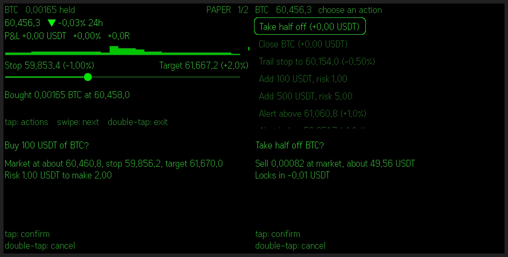

# Riskline

**Your stop, your target and your P&L in R, one glance away. One tap to protect the trade.**

Riskline is an app for Even Realities G2 glasses for people who trade on Binance. It does not try to be a terminal. During a session it answers one question, hands-free: *how is my risk right now?* And it lets you act on the answer with a tap on the temple or the R1 ring.

Built for the Heads Up hackathon, track **Exchanges & Stocks** (Binance).



*Captured from the Even Hub simulator during the recorded demo run: paper trading on live Binance prices. [Watch the 64-second demo](docs/demo.mp4).*

## Read, then write

| You see | You do | What happens |
| --- | --- | --- |
| A position card: price, P&L, R multiple, and a gauge showing where the price sits between your stop and your target | Swipe | Next position, then the rest of your watchlist |
| The same card | Tap | A short list of actions that make sense *right now*: stop to break-even, take half off, close, trail the stop, buy with a stop attached, set an alert |
| An action | Tap to confirm, double-tap to cancel | The order goes out; the result shows for two seconds and gets out of the way |
| An alert card: "Crossed above 61,862", "Near stop", "Near target" | Tap | The one protective action that fits, spelled out on the card before you tap. Swipe to dismiss |
| The system menu (tap, then hold) | Pick "Flatten all" or "Pause alerts" | Works from any screen |
| Any position card | Hold, say "sell half", release | The same confirmation a tap would open. Speech never sends an order by itself |

## Three rules the app keeps

1. **Every entry has a stop.** Buying from the glasses places a stop and a target with the order, sized from the real fill price.
2. **One tap can only reduce risk.** Alert cards offer moving the stop up, taking half off or closing. Anything that adds risk lives behind the action list and a confirmation.
3. **Never act on stale data.** Without a fresh price the action list does not open, and every action is rebuilt from live numbers at the moment you confirm it.

1R is fixed by the first stop of a position, so moving the stop later does not rewrite how the trade is scored.

## Try it

**In a browser, no glasses needed.** `npm install`, then `npm run dev` and open the printed address. When no glasses are found the page becomes a preview: a green panel mirrors the display and four buttons stand in for the touchpad.

**In the simulator.** With the dev server running:

```bash
npm run simulate
```

**On G2.** `evenhub qr --url http://<your-computer>:5173` and scan the code in the Even Realities App, or `npm run pack` and install the `.ehpk`.

The app starts with a paper account of 10,000 USDT that fills at live Binance prices. Prices, 24-hour history and trading increments come from Binance public market data; no account or key is involved.

## Voice

Hold the touchpad, speak, release: "sell half", "stop to break-even", "close", "buy 500", "alert above 62 thousand", "show ethereum", "flatten". The glasses record only while you hold. The phrase goes through a small fixed grammar, not a language model, so it can only ever resolve to one of the actions the menu already offers, and it still lands on the confirmation screen.

Speech-to-text is bring-your-own: enter any OpenAI-compatible transcription endpoint and your key on the phone page. Without one, the same commands can be typed there.

## Real orders on the Binance Spot Testnet

Paper mode needs nothing. To send real orders to the [Spot Testnet](https://testnet.binance.vision), run the bridge with your own testnet key:

```bash
BINANCE_KEY=... BINANCE_SECRET=... node server/bridge.mjs
```

It prints a token. Enter the bridge address and the token on the phone page under **Account**. From then on a tap on the glasses places market orders, and stops and targets become OCO orders on the exchange. The bridge keeps the key on your machine, signs every request itself, takes one request at a time, and refuses to start against anything but the testnet.

## The demo video is reproducible

`scripts/record.mjs` plays `scripts/story.json` (captions and touchpad actions) through the simulator's automation API, saves the glasses framebuffer after every step and builds the MP4 with ffmpeg:

```bash
npm run dev
evenhub-simulator "http://localhost:5173/?reset=1&watch=BTCUSDT,ETHUSDT&sizes=100,500&say=sell%20half" --automation-port 9898
npm run demo:record
```

Nobody can speak into an automated run, so each `say=` in the address stands in for one voice transcript. Parsing, the confirmation and the order are the real path, and the video says so on screen. Prices are live, so every recording shows different numbers.

## How it is built

```
src/core      pure logic: paper venue, positions, R, alerts, the action catalogue, the command grammar
src/ui        pages (576x288 layouts), controller, display adapter, event mapping
src/market    Binance public data: mini-ticker stream with REST fallback
src/companion.ts  the phone page: display mirror, watchlist, defaults, venue
server/       optional testnet bridge, Node built-ins only
test/         48 tests, run with `npm test`
```

- **Layouts are data.** A page is a list of boxes; the display adapter turns it into SDK calls. The first page uses `createStartUpPageContainer`, a new layout uses `rebuildPageContainer`, and a price tick only sends `textContainerUpgrade` for the lines that changed. Calls are serialised, bursts collapse to the newest page, and each call has a timeout.
- **The font is proportional**, so alignment is measured with `@evenrealities/pretext`, not counted in characters. The gauge and sparkline use glyphs from the firmware font.
- **Five brightness levels** carry the hierarchy: price and P&L are brightest, hints are dimmest.
- **State survives a suspended WebView.** Account, alerts and settings are written to `localStorage` on every change.
- The app code has two runtime dependencies, both from Even Realities: the SDK and pretext.

## What has been tested, and how

- Logic, layouts (box limits, one input target, text inside its box), display traffic, event mapping, request signing, the bridge protocol, the command grammar and the demo recorder: 48 automated tests.
- The whole app in a desktop browser against live Binance data, in preview mode.
- The whole demo story in the Even Hub simulator 0.9.5, driven through its automation API on 24 November 2026: watch cards, buy with automatic stop and target, the action list, a scripted "sell half", the system menu and Flatten all. The app logged no errors during the run; the frames above and the demo video come from it.
- Packaging: `npm run pack` type-checks, builds and stamps `riskline.ehpk` (89 KB) with the Even Hub CLI for SDK 0.0.16.

Not done: the bridge has not been run against the exchange yet, voice has been exercised with typed, scripted and mocked transcripts but not with a live speech service, and nothing has been tested on physical glasses (the package has been built, not installed on a device).

## Limits

Spot and long-only. The paper venue fills at the last traded price with a flat 0.1% fee and no slippage. This is a tool for managing a position you chose to take; it gives no advice and never touches real funds.

## Hackathon notes

Everything in this repository was written during the hackathon week. Nothing existed before 23 November 2026.

MIT licence.
